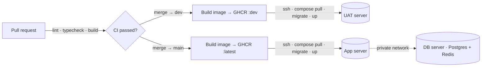

<!--
  Profile README for github.com/meencodes
  Lives in the repo  meencodes/meencodes  as README.md
-->

 

<!-- Social links — fill in and uncomment the ones you want

-->

## 🧑‍💻 About me

- 🛒 Currently building a **headless e-commerce platform** (Next.js storefront · Payload CMS · NestJS API) and a **multi-tenant inventory / ERP system** for a retail brand in Thailand.
- 🔁 Came up through **Angular + Express + MySQL**, moved to **Next.js + NestJS + Prisma + Postgres**, and shipped a few **Ethereum / ERC-20** projects along the way.
- 🧭 Things I keep coming back to: typed contracts end-to-end, queues over cron, **one service = one compose file**, and a real UAT before anything touches prod.
- 🤖 I pair-program with AI every day (Claude Code, `AGENTS.md` conventions in every repo) and write my docs in Thai, my code in TypeScript.
- 🇹🇭 Based in Bangkok.

## 🛠️ Tech stack

 

 

 

 

<table>
  <tr>
    <td width="170"><b>Languages</b></td>
    <td>
      
      
      
      
      
      
      
    </td>
  </tr>
  <tr>
    <td><b>Frontend</b></td>
    <td>
      
      
      
      
      
      
      
      
      
      
      
    </td>
  </tr>
  <tr>
    <td><b>Backend</b></td>
    <td>
      
      
      
      
      
      
      
      
      
      
      
      
    </td>
  </tr>
  <tr>
    <td><b>CMS &amp; Data</b></td>
    <td>
      
      
      
      
      
      
    </td>
  </tr>
  <tr>
    <td><b>DevOps &amp; Cloud</b></td>
    <td>
      
      
      
      
      
      
      
      
      
      
    </td>
  </tr>
  <tr>
    <td><b>Testing &amp; Tooling</b></td>
    <td>
      
      
      
      
      
      
      
      
      
      
      
    </td>
  </tr>
  <tr>
    <td><b>Integrations</b></td>
    <td>
      
      
      
      
      
      
      
      
      
      
    </td>
  </tr>
</table>

## 🏗️ Things I've built

<table>
  <tr>
    <td width="50%" valign="top">
      <h3>🛍️ Headless commerce platform</h3>
      

        Next.js 16 storefront (App Router, React 19, Tailwind v4, shadcn/ui) ·
        Payload CMS 3 on Postgres with S3 media ·
        NestJS API with Prisma 7 + BullMQ workers on Redis.
      

      

        Omise / PromptPay checkout, LINE LIFF login, subscription orders,
        Thai tax-invoice flow, rewards &amp; coupons, cookie-consent records.
      

    </td>
    <td width="50%" valign="top">
      <h3>🏭 Multi-tenant inventory / ERP</h3>
      

        NestJS + Prisma API: products &amp; GTINs, purchase orders with carton labels,
        scan-to-receive with lot / expiry and FEFO picking, stock transfers,
        HMAC-signed store webhooks, Flash Express booking, passkey (WebAuthn) login.
      

      

        Next.js admin with QR / barcode scanning · order sync from Shopee, Lazada and TikTok Shop.
      

    </td>
  </tr>
  <tr>
    <td width="50%" valign="top">
      <h3>📦 Order &amp; CRM platform</h3>
      

        Angular apps (v12 → v21, SSR) over Express services on MySQL + MongoDB,
        RabbitMQ workers, Socket.IO realtime, scheduled jobs, LINE and Facebook bots,
        PDF / Excel / shipping-label generation and a public parcel-tracking site.
      

    </td>
    <td width="50%" valign="top">
      <h3>🚀 Infra &amp; delivery</h3>
      

        Three-VM layout (app / db / UAT) on a private network, Nginx + certbot in front,
        one Docker Compose file per service, Dozzle for logs.
      

      

        GitHub Actions: PR gate (lint · typecheck · build) → multi-stage Bun image →
        GHCR → SSH deploy with Prisma migrations.
      

    </td>
  </tr>
</table>

## ⚙️ How I ship

## 📊 GitHub stats

Most of my day-to-day work lives in private org repos, so the numbers above are only the tip of the iceberg.

 

